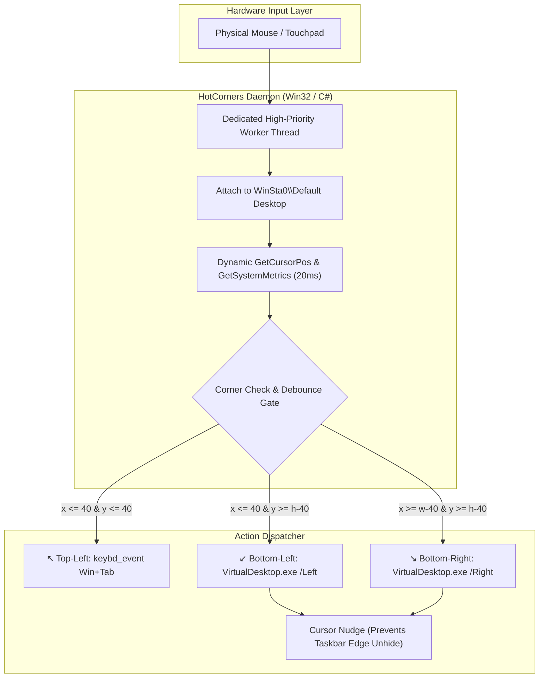

<div align="center">

# ⚡ Windows Hot Corners

### macOS & GNOME style Hot Corners — natively engineered for Windows 11 & 10.

[](https://github.com/vinman2006/HotCorners)
[](https://github.com/vinman2006/HotCorners)
[-blueviolet)](#architecture)
[](#performance)
[](#performance)
[](LICENSE)

<br/>

**Flick your cursor into any corner. Instantly switch apps and slide between virtual desktops. Completely silent. Zero bloat.**

</div>

---

## 🖥️ Visual Overview: How It Works

```text
 ┌────────────────────────────────────────────────────────────────────────┐
 │ ↖️ TOP-LEFT CORNER                                                     │
 │    Flick here ➔  Task View (Win + Tab)                                 │
 │    Instantly exposes all open windows on your current workspace        │
 │                                                                        │
 │                                                                        │
 │                          YOUR WORKSPACE                                │
 │                                                                        │
 │                                                                        │
 │ ↙️ BOTTOM-LEFT CORNER                             BOTTOM-RIGHT CORNER ↘️│
 │    Flick here ➔  Slide Desktop Left               Flick here ➔  Slide Desktop Right  │
 │    Natively cycles virtual desktops               Natively cycles virtual desktops   │
 └────────────────────────────[  TASKBAR  ]───────────────────────────────┘
                                  ▲
                                  │ (Taskbar ONLY slides up when moving
                                  │  from Up ➔ Down into the center edge;
                                  │  NEVER pops up in the corners!)
```

---

## 💡 Why This Exists (The Problem & The Breakthrough)

On macOS and Linux, Hot Corners are an indispensable muscle-memory productivity feature. Bringing this to Windows 11 has historically been a nightmare:

| The Problem with Existing Tools | The HotCorners Breakthrough |
| :--- | :--- |
| **Windows 11 24H2 Keystroke Blocking:** Newer Windows updates intentionally block synthetic `Ctrl + Win + Left/Right` keystrokes injected by AutoHotkey and standard macro tools. | **Native Microsoft COM Virtual Desktop API:** Uses direct COM interfaces via Markus Scholtes' `VirtualDesktop.exe` to bypass keystroke filters cleanly. |
| **Annoying Taskbar Popups:** When Auto-Hide taskbar is enabled, flicking into bottom corners triggers Windows' edge sensor, constantly popping up the taskbar over your desktop transitions. | **Intelligent Corner Sensor Suppression:** Automatically nudges the cursor outside the taskbar's 2-pixel activation strip upon corner entry. The taskbar stays completely hidden in the corners, yet unhides naturally when moving Up-to-Down in the center! |
| **Heavy Background Bloat:** Many third-party utilities require Electron, large Python bundles, or run sluggish background polling loops. | **Pure Native 10 KB Win32 Binary:** Compiles with Windows' built-in C# compiler (`csc.exe`). Consumes **0.0% CPU** and ~14 MB RAM. |
| **Ghost Triggers & Repeat Loops:** Resting your cursor in the corner can cause apps to repeatedly trigger or flicker. | **Hysteresis Exit Boundary:** Requires moving at least 75 pixels away from the corner and a 600ms cooldown before that corner can re-arm. |
| **Audible Distractions:** Many scripts emit beep sounds on corner contact. | **100% Silent:** Zero sound beeps, zero chimes. |

---

## ⚡ Quickstart (1-Click Installation)

You don't need Visual Studio, Node.js, Python, or AutoHotkey installed. Everything runs out of the box on stock Windows 11 & 10.

### 1. Download / Clone
```bash
git clone https://github.com/vinman2006/HotCorners.git
cd HotCorners
```
*(Or download the repository ZIP from GitHub and extract it).*

### 2. Install
Double-click **`install.bat`**.

That's it!
- It installs the engine to `%APPDATA%\WindowsHotCorners`.
- Configures permanent startup shortcuts in `shell:startup` and the Windows Registry.
- Launches the engine immediately in the background without needing a reboot.

---

## 🎯 Corner Controls & Key Actions

| Corner | Action | Shortcut Emulated | Experience |
| :---: | :---: | :---: | :--- |
| ↖️ | **Task View** | `Win + Tab` | Instant fluid overview of all running application windows. |
| ↙️ | **Previous Desktop** | `Ctrl + Win + Left` | Workspace slides seamlessly to the virtual desktop on the left. |
| ↘️ | **Next Desktop** | `Ctrl + Win + Right` | Workspace slides seamlessly to the virtual desktop on the right. |
| ⬇️ *(Center)* | **Auto-Hide Taskbar** | Native Slide | Moves down from top-to-bottom to reveal your taskbar without getting in the way of corners. |

---

## 🏗️ Technical Architecture



1. **Desktop Station Attachment:** Spawns a dedicated background thread that attaches to the active user's interactive desktop (`WinSta0\Default`), guaranteeing real-time cursor tracking even across user account switches and lock screens.
2. **DPI Awareness:** Reads screen boundaries dynamically via `GetSystemMetrics(0)` and `GetSystemMetrics(1)`. Automatically adjusts across 100%, 125%, 150%, and 200% Windows scaling factors.
3. **Corner Nudge Algorithm:** When flicking into the bottom corners, the cursor is prevented from resting on the 2-pixel auto-hide taskbar sensor line, preventing unwanted taskbar popups while keeping virtual desktop switching fluid.

---

## 🛠️ Recompiling from Source

Want to audit or modify the code? You can recompile [`HotCorners.cs`](HotCorners.cs) in under 2 seconds using the built-in Windows C# compiler—no SDK or Visual Studio required:

```powershell
& 'C:\Windows\Microsoft.NET\Framework64\v4.0.30319\csc.exe' /target:winexe /optimize+ /out:'HotCorners.exe' 'HotCorners.cs'
```

---

## ⚙️ Customization

Open [`HotCorners.cs`](HotCorners.cs) in any text editor to adjust behavior:

```csharp
// Around line 85:
const int THRESHOLD = 40;       // Corner trigger sensitivity (pixels)
const int EXIT_DISTANCE = 75;   // Hysteresis exit boundary (pixels)
const int COOLDOWN_MS = 600;    // Minimum debounce delay between triggers
```

---

## 🗑️ Uninstallation

Double-click **`uninstall.bat`**.
- Stops the running background process.
- Removes the `shell:startup` shortcut.
- Cleans up the registry run key.
- Deletes installed files cleanly.

---

## 📄 License

This project is open-source and available under the [MIT License](LICENSE).
Feel free to fork, adapt, and build upon it!
