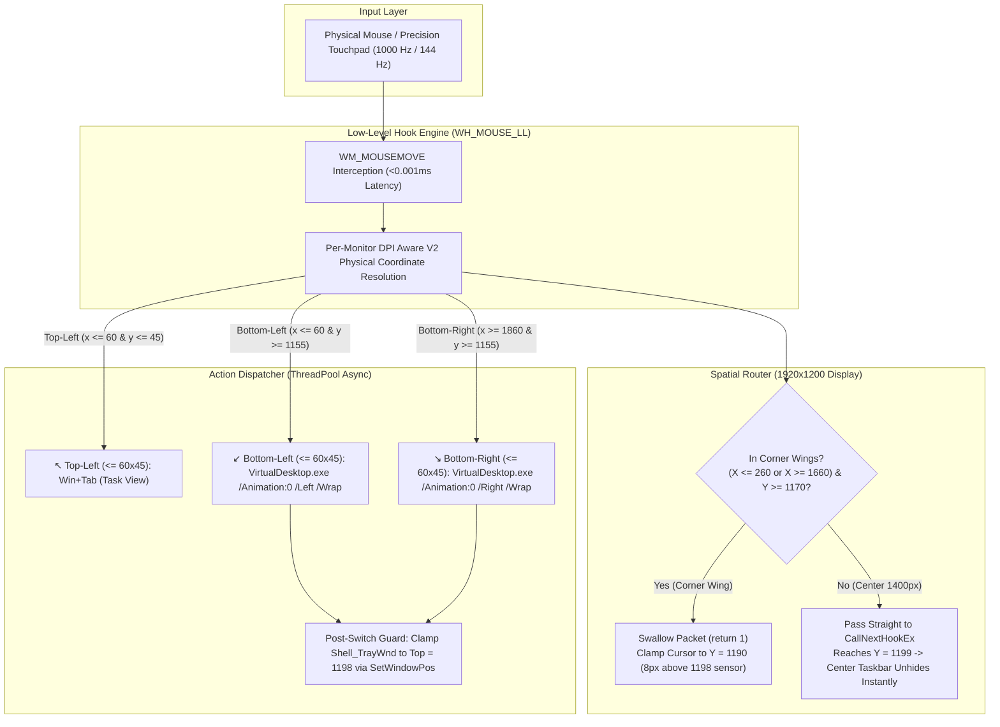

<div align="center">

# ⚡ Windows Hot Corners v3.3

### macOS & GNOME style Hot Corners — natively engineered for Windows 11 & 10.
### Featuring Corner Taskbar Immunity & Unrestricted Center Auto-Hide.

[](https://github.com/vinman2006/HotCorners)
[](https://github.com/vinman2006/HotCorners)
[-blueviolet)](#architecture)
[](#performance)
[](#performance)
[](RESEARCH.md)
[](HotCorners_Debugging_Prompt.md)
[](LICENSE)

<br/>

**Flick your cursor into any corner. Instantly switch apps and slide between virtual desktops. Completely silent. Zero bloat. The corners are 100% immune to the taskbar.**

</div>

---

## 🖥️ Visual Overview: How It Works

```text
 ┌────────────────────────────────────────────────────────────────────────┐
 │ ↖️ TOP-LEFT CORNER                                                     │
 │    Flick here ➔  Task View (Win + Tab)                                 │
 │    Instantly exposes all open windows on your current workspace        │
 │                                                                        │
 │                                                                        │
 │                          YOUR WORKSPACE                                │
 │                                                                        │
 │                                                                        │
 │ ↙️ BOTTOM-LEFT CORNER                             BOTTOM-RIGHT CORNER ↘️│
 │    Flick here ➔  Slide Desktop Left               Flick here ➔  Slide Desktop Right  │
 │    [CORNER IMMUNITY: 260px SHIELD]                [CORNER IMMUNITY: 260px SHIELD]    │
 └────────────────────────────[  TASKBAR  ]───────────────────────────────┘
                                   ▲
                                   │ (Taskbar slides up naturally and smoothly
                                   │  whenever you move your mouse to the 1400px center edge;
                                   │  the left and right corners are 100% IMMUNE!)
```

---

## 💡 Why This Exists (The Problem & The Breakthrough)

On macOS and Linux, Hot Corners are an indispensable muscle-memory productivity feature. Bringing this to Windows 11 has historically been a nightmare due to taskbar and virtual desktop conflicts.

For complete reverse-engineering and empirical test logs, read our comprehensive [**Research Documentation (RESEARCH.md)**](RESEARCH.md).

| The Problem with Existing Tools | The HotCorners v3.2 Breakthrough |
| :--- | :--- |
| **Windows 11 24H2 Keystroke Blocking:** Newer Windows updates intentionally block synthetic `Ctrl + Win + Left/Right` keystrokes injected by AutoHotkey and standard macro tools. | **Native Microsoft COM Virtual Desktop API:** Uses direct COM interfaces via Markus Scholtes' `VirtualDesktop.exe` with instantaneous switch execution. |
| **Desktop Switch Banner Collision:** Switching virtual desktops in Windows 11 pops up an on-screen workspace name banner right over the bottom-center sensor, waking `Shell_TrayWnd` and locking it open for 5+ seconds. | **Switch Animation Suppression (`/Animation:0`):** Calling `VirtualDesktop.exe` with `/Animation:0` completely suppresses the banner, allowing seamless zero-stutter desktop sliding without waking the taskbar. |
| **Diagonal Flick Sensor Wake:** Rapid diagonal swipes toward the corners hit the bottom edge at $X \approx 130\text{--}180\text{px}$, bypassing narrow shields and waking the taskbar at $Y \ge 1198$. | **Generous 260px Spatial Shield Wings:** $260\text{px}$ wide wings ($X \le 260$ and $X \ge 1660$) capture all diagonal trajectories early, holding the cursor safely at $Y = 1190$ ($8\text{px}$ above the $1198$ sensor) and swallowing all corner packets. |
| **Center Taskbar Trapping ("Reverse Bug"):** Attempting to use global `ClipCursor` traps the cursor and blocks intentional mouse moves in the center. | **1400px Unrestricted Center Edge:** The center bottom region ($260 < X < 1660$) has zero hook interference. Mouse packets pass through with $0\,\mu\text{s}$ delay, allowing the auto-hide taskbar to unhide smoothly and immediately. |
| **Rogue Focus Shifts During Transitions:** Desktop switching can occasionally cause Windows Explorer to steal foreground focus and slide up `Shell_TrayWnd`. | **Post-Switch Auto-Hide Enforcer:** A background verification thread monitors `Shell_TrayWnd` post-switch and clamps it back to $Y = 1198$ via `SetWindowPos(..., SWP_NOSIZE | SWP_NOZORDER | SWP_NOACTIVATE | SWP_NOSENDCHANGING)`. |
| **Heavy Background Bloat:** Many third-party utilities require Electron, Python runtimes, or sluggish polling loops. | **Pure Native Win32 Binary:** Compiles with Windows' built-in C# compiler (`csc.exe`). Consumes **0.0% CPU** and ~20 MB RAM. |
| **Ghost Triggers & Repeat Loops:** Resting your cursor in the corner can cause apps to repeatedly trigger or flicker. | **Hysteresis Exit Boundary:** Requires moving at least 75 pixels away from the corner and waiting 400ms before that corner can re-arm. |
| **Audible Distractions:** Many scripts emit beep sounds on corner contact. | **100% Silent:** Zero sound beeps, zero chimes. |

---

## ⚡ Quickstart (1-Click Installation)

You don't need Visual Studio, Node.js, Python, or AutoHotkey installed. Everything runs out of the box on stock Windows 11 & 10.

### 1. Download / Clone
```bash
git clone https://github.com/vinman2006/HotCorners.git
cd HotCorners
```
*(Or download the repository ZIP from GitHub and extract it).*

### 2. Install
Double-click **`install.bat`**.

That's it!
- It installs the engine to `%APPDATA%\WindowsHotCorners`.
- Configures permanent startup shortcuts in `shell:startup` and the Windows Registry.
- Launches the engine immediately in the background without needing a reboot.

---

## 🎯 Corner Controls & Key Actions

| Corner | Default State | Action | Mechanism | Experience |
| :---: | :---: | :---: | :---: | :--- |
| ↖️ *(Top-Left)* | **ACTIVE** | **Task View (`Win + Tab`)** | `Shell.Application.WindowSwitcher()` | Opens Windows Task View (`Win + Tab`) with 0 synthetic keystrokes; tray-toggleable to **Alt+Tab Popup**. |
| 🖱️ *(Inside Task View)* | **ACTIVE** | **Scroll Virtual Desktops** | `WH_MOUSE_LL` (`WM_MOUSEWHEEL` / `WM_MOUSEHWHEEL`) -> `Ctrl + Win + Left/Right` | Linux GNOME-style workspace switching: scroll wheel Up/Down (or 2-finger touchpad swipe) inside `Win + Tab` Task View switches desktops cleanly while keeping Task View open! |
| ↙️ *(Bottom-Left)* | *Disabled (Native)* | **Previous Desktop** | `Ctrl + Win + Left` | Stock native Windows behavior by default; toggleable via `ENABLE_BOTTOM_LEFT`. |
| ↘️ *(Bottom-Right)* | *Disabled (Native)* | **Next Desktop** | `Ctrl + Win + Right` | Stock native Windows behavior by default; toggleable via `ENABLE_BOTTOM_RIGHT`. |
| ⬇️ *(Bottom Edge)* | **ACTIVE** | **Taskbar Auto-Hide** | Native Slide | Moves down to reveal taskbar 100% natively without interference. |

---

## 🏗️ Technical Architecture



1. **Tight 60×45 px Intentional Hitboxes:** Corner triggers are tuned for deliberate physical flicks. Casual mouse navigation, selecting text, or clicking scrollbars never triggers desktop switching.
2. **260px Spatial Shield Wings:** Left wing ($X \le 260$) and right wing ($X \ge 1660$) capture all diagonal trajectories, keeping a massive $1400\text{px}$ center edge ($260 < X < 1660$) completely open.
3. **Kernel `ClipCursor` Safety & Selective Overshoot Swallow:** Pre-arms a kernel `ClipCursor` ceiling at $Y \le 1190$ ($8\text{px}$ above the $1198$ taskbar sensor) inside the corner wings, with zero synthetic `SetCursorPos` event injection. Only packets attempting to cross $rawY > 1190$ are swallowed, keeping horizontal $X$ sliding and upward motion 100% fluid.
4. **Switch Animation Suppression:** Calls `VirtualDesktop.exe` with `/Animation:0 /Quiet /Left|Right /Wrap`, removing the Windows 11 desktop switch overlay that stole focus and forced `Shell_TrayWnd` to pop up.
5. **Post-Switch Clamping:** Any rogue focus attempt is immediately corrected by `SetWindowPos(hTray, ..., SWP_NOSIZE | SWP_NOZORDER | SWP_NOACTIVATE | SWP_NOSENDCHANGING)`.
6. **1400px Frictionless Center Taskbar:** Between $X = 260$ and $X = 1660$, mouse input passes through untouched with zero latency, unhiding the auto-hide taskbar naturally.
7. **Built-in Verification Diagnostics:** Launch `HotCorners.exe --verify` anytime to inspect active physical metrics, shield boundaries, and taskbar states.

---

## 🛠️ Recompiling from Source

You can recompile [`HotCorners.cs`](HotCorners.cs) in under 2 seconds using the built-in Windows C# compiler—no SDK or Visual Studio required:

```powershell
& 'C:\Windows\Microsoft.NET\Framework64\v4.0.30319\csc.exe' /target:winexe /optimize+ /win32icon:'HotCorners.ico' /out:'HotCorners.exe' 'HotCorners.cs'
```

---

## ⚙️ Customization

Open [`HotCorners.cs`](HotCorners.cs) in any text editor to adjust behavior:

```csharp
private const int CORNER_W = 4;              // Strict corner-touch trigger width (0..4 px)
private const int CORNER_H = 4;              // Strict corner-touch trigger height (0..4 px)
private const int CORNER_SHIELD_W = 260;     // Taskbar immunity shield wing width (px)
private const int CORNER_SHIELD_H = 30;      // Bottom approach shield height (px)
private const int RESET_HYSTERESIS_PX = 75;  // Distance out of corner to re-arm (px)
private const long TRIGGER_COOLDOWN_MS = 400;// Debounce cooldown between triggers (ms)
```

---

## 🗑️ Uninstallation

Double-click **`uninstall.bat`**.
- Stops the running background process.
- Removes the `shell:startup` shortcut.
- Cleans up the registry run key.
- Deletes installed files cleanly.

---

## 📄 License

This project is open-source and available under the [MIT License](LICENSE).
Feel free to fork, adapt, and build upon it!
