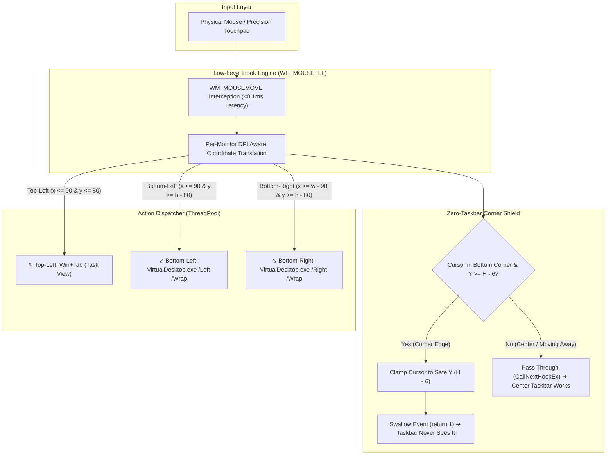

<div align="center">

# ⚡ Windows Hot Corners v2.0

### macOS & GNOME style Hot Corners — natively engineered for Windows 11 & 10.
### Featuring the Zero-Taskbar Corner Shield (Driver-Level Suppression).

[](https://github.com/vinman2006/HotCorners)
[](https://github.com/vinman2006/HotCorners)
[-blueviolet)](#architecture)
[](#performance)
[](#performance)
[](LICENSE)

<br/>

**Flick your cursor into any corner. Instantly switch apps and slide between virtual desktops. Completely silent. Zero bloat.**

</div>

---

## 🖥️ Visual Overview: How It Works

```text
 ┌────────────────────────────────────────────────────────────────────────┐
 │ ↖️ TOP-LEFT CORNER                                                     │
 │    Flick here ➔  Task View (Win + Tab)                                 │
 │    Instantly exposes all open windows on your current workspace        │
 │                                                                        │
 │                                                                        │
 │                          YOUR WORKSPACE                                │
 │                                                                        │
 │                                                                        │
 │ ↙️ BOTTOM-LEFT CORNER                             BOTTOM-RIGHT CORNER ↘️│
 │    Flick here ➔  Slide Desktop Left               Flick here ➔  Slide Desktop Right  │
 │    [TASKBAR SHIELD: 100% SUPPRESSED]              [TASKBAR SHIELD: 100% SUPPRESSED]  │
 └────────────────────────────[  TASKBAR  ]───────────────────────────────┘
                                   ▲
                                   │ (Taskbar ONLY slides up when moving
                                   │  from Up ➔ Down into the center edge;
                                   │  NEVER pops up in the corners!)
```

---

## 💡 Why This Exists (The Problem & The Breakthrough)

On macOS and Linux, Hot Corners are an indispensable muscle-memory productivity feature. Bringing this to Windows 11 has historically been a nightmare:

| The Problem with Existing Tools | The HotCorners v2.0 Breakthrough |
| :--- | :--- |
| **Windows 11 24H2 Keystroke Blocking:** Newer Windows updates intentionally block synthetic `Ctrl + Win + Left/Right` keystrokes injected by AutoHotkey and standard macro tools. | **Native Microsoft COM Virtual Desktop API:** Uses direct COM interfaces via Markus Scholtes' `VirtualDesktop.exe` to bypass keystroke filters cleanly. |
| **Annoying Taskbar Popups at Corners:** When Auto-Hide taskbar is enabled, flicking into bottom corners triggers Windows' edge sensor (`Y >= H - 2`), popping up the taskbar over your desktop transitions. | **Zero-Taskbar Corner Shield (`WH_MOUSE_LL`):** A driver-level mouse hook intercepts corner movement and clamps the cursor precisely 6px above the display edge. Out-of-bounds raw mouse messages are swallowed at the OS level—Windows Explorer's taskbar sensor **never receives mouse input in the corners**. The taskbar stays 100% hidden in corners, but slides up instantly when moving Up-to-Down in the center! |
| **Heavy Background Bloat:** Many third-party utilities require Electron, large Python bundles, or run sluggish background polling loops. | **Pure Native 11 KB Win32 Binary:** Compiles with Windows' built-in C# compiler (`csc.exe`). Consumes **0.0% CPU** and ~11 MB RAM. |
| **Ghost Triggers & Repeat Loops:** Resting your cursor in the corner can cause apps to repeatedly trigger or flicker. | **Hysteresis Exit Boundary:** Requires moving at least 140 pixels away from the corner and a 400ms cooldown before that corner can re-arm. |
| **Audible Distractions:** Many scripts emit beep sounds on corner contact. | **100% Silent:** Zero sound beeps, zero chimes. |
| **DPI Scaling Mismatches:** High-DPI screens (125%, 150%, 200%) often calculate wrong corner hitboxes. | **Per-Monitor DPI Awareness:** Calls `SetProcessDPIAware()` to align physical screen metrics with hardware cursor coordinates 1:1. |

---

## ⚡ Quickstart (1-Click Installation)

You don't need Visual Studio, Node.js, Python, or AutoHotkey installed. Everything runs out of the box on stock Windows 11 & 10.

### 1. Download / Clone
```bash
git clone https://github.com/vinman2006/HotCorners.git
cd HotCorners
```
*(Or download the repository ZIP from GitHub and extract it).*

### 2. Install
Double-click **`install.bat`**.

That's it!
- It installs the engine to `%APPDATA%\WindowsHotCorners`.
- Configures permanent startup shortcuts in `shell:startup` and the Windows Registry.
- Launches the engine immediately in the background without needing a reboot.

---

## 🎯 Corner Controls & Key Actions

| Corner | Action | Shortcut Emulated | Experience |
| :---: | :---: | :---: | :--- |
| ↖️ | **Task View** | `Win + Tab` | Instant fluid overview of all running application windows. |
| ↙️ | **Previous Desktop** | `Ctrl + Win + Left` | Workspace slides seamlessly to the virtual desktop on the left. Taskbar stays 100% hidden. |
| ↘️ | **Next Desktop** | `Ctrl + Win + Right` | Workspace slides seamlessly to the virtual desktop on the right. Taskbar stays 100% hidden. |
| ⬇️ *(Center)* | **Auto-Hide Taskbar** | Native Slide | Moves down from top-to-bottom to reveal your taskbar without getting in the way of corners. |

---

## 🏗️ Technical Architecture



1. **Low-Level Hook Engine (`WH_MOUSE_LL`):** Runs an event-driven Win32 hook at the OS driver boundary. Requires **0.0% CPU** (no polling loops).
2. **Zero-Taskbar Corner Shield:** The Windows 11 Auto-Hide taskbar unhides whenever cursor coordinates touch `Y >= H - 2`. HotCorners v2.0 enforces a safe boundary at `H - 6` in the bottom corners by clamping the cursor and swallowing the raw input event. The taskbar stays completely hidden during virtual desktop shifts.
3. **Desktop Station Attachment:** Spawns a dedicated worker thread attached to `WinSta0\Default`, guaranteeing real-time cursor tracking across user account switches and lock screens.
4. **Non-blocking ThreadPool Workers:** Virtual desktop COM calls and keystroke injections run asynchronously on background threads so cursor movement never stalls or drops frames.

---

## 🛠️ Recompiling from Source

Want to audit or modify the code? You can recompile [`HotCorners.cs`](HotCorners.cs) in under 2 seconds using the built-in Windows C# compiler—no SDK or Visual Studio required:

```powershell
& 'C:\Windows\Microsoft.NET\Framework64\v4.0.30319\csc.exe' /target:winexe /optimize+ /out:'HotCorners.exe' 'HotCorners.cs'
```

---

## ⚙️ Customization

Open [`HotCorners.cs`](HotCorners.cs) in any text editor to adjust behavior:

```csharp
const int CORNER_W = 90;        // Corner width in physical pixels
const int CORNER_H = 80;        // Corner height in physical pixels
const int EXIT_DIST = 140;      // Distance to re-arm corner trigger
const int COOLDOWN_MS = 400;    // Minimum debounce delay between triggers
int safeY = h - 6;              // Barrier 6px above bottom edge (taskbar sensor is at h - 2)
```

---

## 🗑️ Uninstallation

Double-click **`uninstall.bat`**.
- Stops the running background process.
- Removes the `shell:startup` shortcut.
- Cleans up the registry run key.
- Deletes installed files cleanly.

---

## 📄 License

This project is open-source and available under the [MIT License](LICENSE).
Feel free to fork, adapt, and build upon it!
